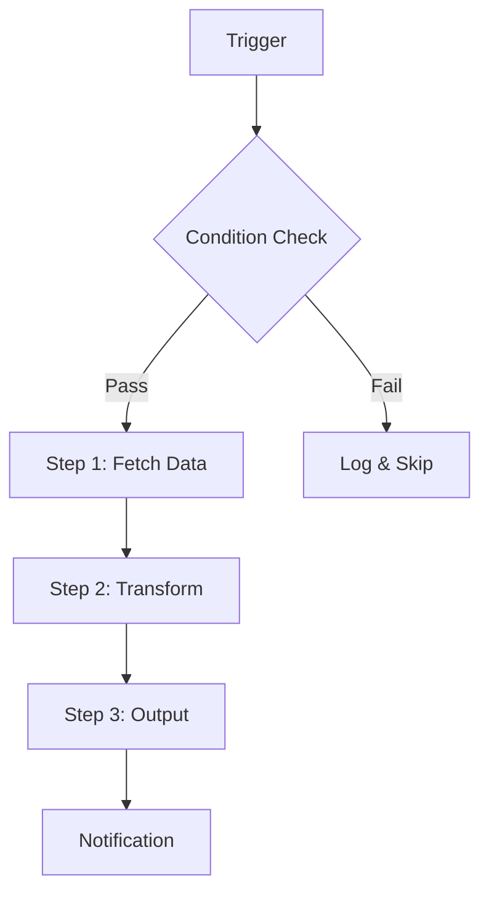

# Automation Specification

## Overview

| Field | Value |
|-------|-------|
| **Name** | {Automation Name} |
| **Owner** | {Name / Team} |
| **Status** | Draft / In Review / Approved / Active |
| **Created** | YYYY-MM-DD |
| **Last Updated** | YYYY-MM-DD |

## Problem Statement

{What manual process does this automate? How much time/money does it currently cost?}

**Current state:**
- Steps: {N} manual steps
- Frequency: {daily/weekly/on-demand}
- Time per execution: {X minutes/hours}
- Error rate: {estimated %}

## Automation Design

### Trigger

| Trigger Type | Details |
|-------------|---------|
| **Event** | {e.g., "New row in Airtable", "Webhook from Stripe"} |
| **Schedule** | {e.g., "Daily at 9:00 AM UTC"} |
| **Manual** | {e.g., "Slack command /run-report"} |

### Workflow Steps

| Step | Action | Input | Output | Error Handling |
|------|--------|-------|--------|----------------|
| 1 | {Action} | {Input source} | {What it produces} | {What happens on failure} |
| 2 | {Action} | {From Step 1} | {What it produces} | {What happens on failure} |
| 3 | {Action} | {From Step 2} | {What it produces} | {What happens on failure} |

### Integrations

| Service | Purpose | Auth Method |
|---------|---------|-------------|
| {Service} | {What it does in this flow} | {API Key / OAuth / Token} |

## Success Criteria

- [ ] Process completes in under {X} seconds
- [ ] Error rate < {X}%
- [ ] Manual intervention required < {X}% of runs
- [ ] Output matches expected format/schema

## Failure Handling

| Failure Type | Response | Escalation |
|-------------|----------|------------|
| API timeout | Retry 3x with exponential backoff | Alert #ops-alerts after 3 failures |
| Invalid input | Log warning, skip record | Include in daily summary |
| Partial failure | Save progress, resume from checkpoint | Manual review queue |

## Monitoring

- **Health check:** {How to verify it's running}
- **Alerts:** {What triggers an alert}
- **Dashboard:** {Where to see metrics}
- **Logs:** {Where to find execution logs}

## Rollback Plan

{How to revert if the automation causes issues. Include manual fallback procedure.}

## Approval

| Role | Name | Date | Decision |
|------|------|------|----------|
| Requester | | | |
| Technical Review | | | |
| Business Owner | | | |
